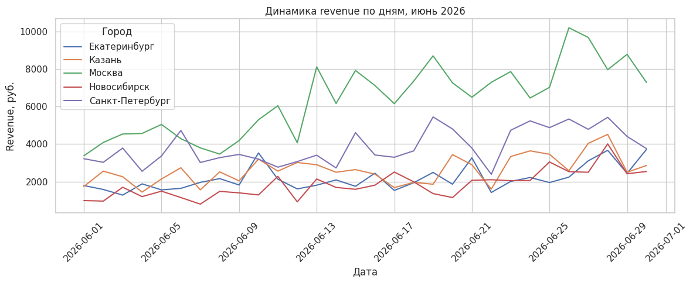
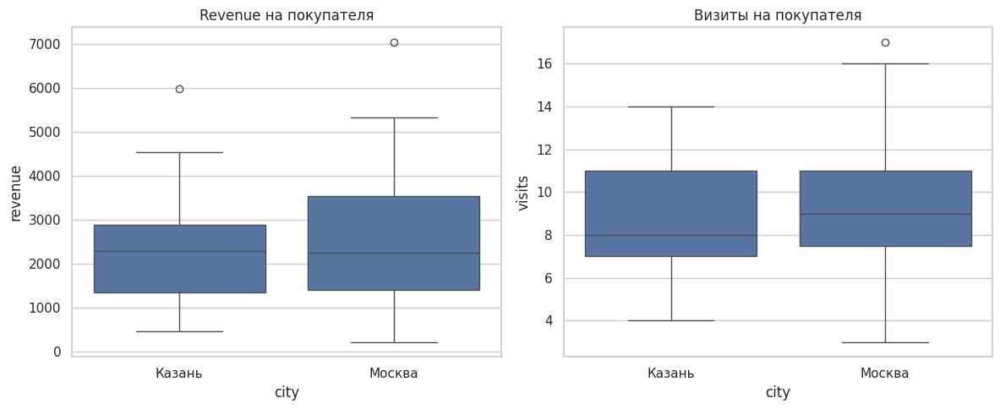
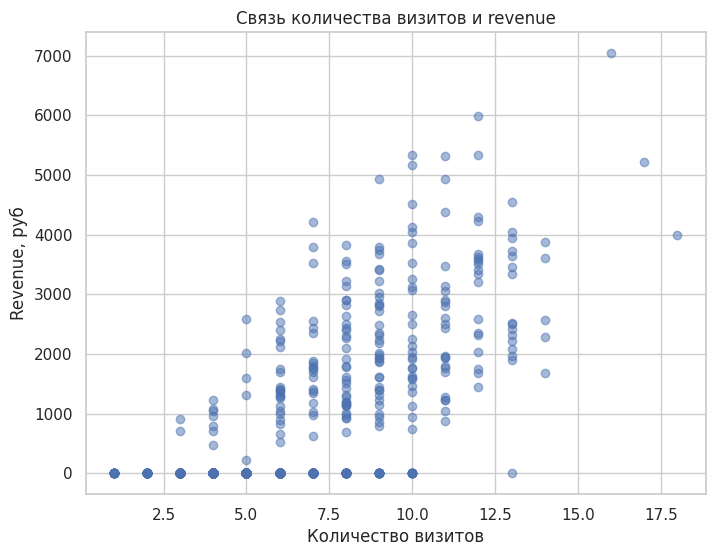

# Продуктовые метрики онлайн-пекарни «Мякушка»

Учебный кейс: по выгрузке событий приложения за июнь 2026 года посчитать ключевые
метрики магазина, найти города с наибольшим ростом выручки, сравнить покупателей
Москвы и Казани и проверить, связана ли активность пользователя с выручкой.

## Результаты

### Метрики за июнь

| Revenue | MAU | Buyers | Orders |
|---:|---:|---:|---:|
| 505 120 ₽ | 882 | 221 | 1 196 |

### Рост выручки по городам

Сравнивается первая неделя месяца (1-7 июня) с последней (24-30 июня): одинаковая
длина, в каждой и будни, и выходные.

| Город | Revenue 1-7 июня, ₽ | Revenue 24-30 июня, ₽ | Рост, ₽ | Рост, % |
|---|---:|---:|---:|---:|
| Москва | 29 720 | 57 440 | +27 720 | +93,3 |
| Новосибирск | 8 290 | 19 110 | +10 820 | +130,5 |
| Санкт-Петербург | 23 710 | 33 850 | +10 140 | +42,8 |
| Казань | 14 440 | 23 600 | +9 160 | +63,4 |
| Екатеринбург | 11 690 | 19 350 | +7 660 | +65,5 |

Москва лидирует по абсолютному росту, Новосибирск - по относительному: у него
самая низкая выручка в начале месяца, поэтому меньший прирост в рублях даёт
больший процент.



### Покупатели Москвы и Казани

| Метрика на покупателя | Москва (75 чел.) | Казань (35 чел.) |
|---|---:|---:|
| Revenue, среднее | 2 543 ₽ | 2 246 ₽ |
| Revenue, медиана | 2 250 ₽ | 2 300 ₽ |
| Визиты, среднее | 9,3 | 8,9 |
| Визиты, медиана | 9 | 8 |

Типичный покупатель в обоих городах тратит примерно одинаково. Среднее в Москве
выше из-за небольшого числа крупных покупателей: максимум 7 040 ₽ против 5 980 ₽,
дисперсия заметно больше. По числу визитов города почти не отличаются.



### Активность и выручка

Корреляция Пирсона между числом визитов и выручкой пользователя - **0,68**.
Но 74,9% пользователей ничего не купили, а несколько очень активных покупателей
тянут коэффициент вверх. Связь есть, но из неё не следует, что рост числа визитов
увеличит выручку.



## Подготовка данных

- Исключены 130 тестовых событий (`source = 'test'`) - в них же были
  нечисловые значения `revenue` (`unknown`).
- `revenue` приведена к числу, `event_timestamp` - к `datetime`.
- Дубликатов нет; пропуски в `order_id` только у событий без покупки, как и должно быть.

## Данные

`myakushka_events.csv` - учебный датасет, 10 772 события (в репозиторий не включён).
Одна строка - одно событие пользователя:

| Столбец | Содержание |
|---|---|
| `event_timestamp` | дата и время события |
| `user_id` | идентификатор пользователя |
| `city` | город пользователя |
| `event_type` | `visit`, `product_view` или `purchase` |
| `order_id` | идентификатор заказа (только для покупок) |
| `revenue` | выручка |
| `source` | канал привлечения: `organic`, `ads`, `referral` или служебная метка `test` |
| `platform` | Android, iOS или web |

Чтобы перезапустить ноутбук, положите файл рядом с ним.

## Стек

Python, pandas, matplotlib, seaborn

## Запуск

```bash
pip install -r requirements.txt
jupyter notebook product_metrics_analysis.ipynb
```

## Структура

```
.
├── product_metrics_analysis.ipynb   # исследование: 4 задачи с кодом и выводами
├── images/                          # графики для README
├── requirements.txt
└── README.md
```
